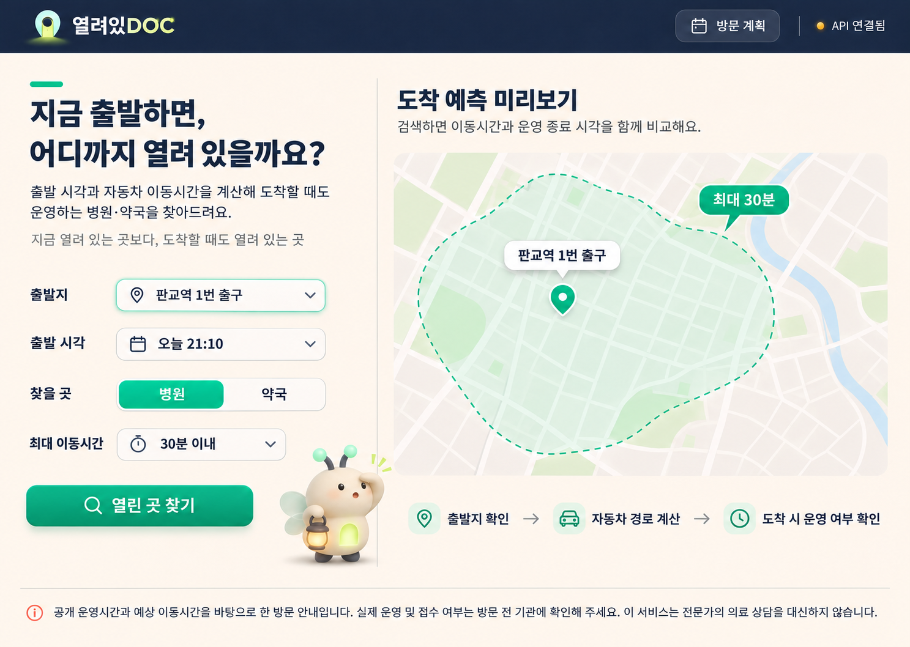
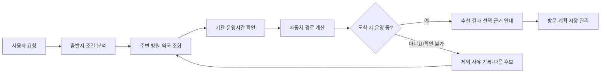
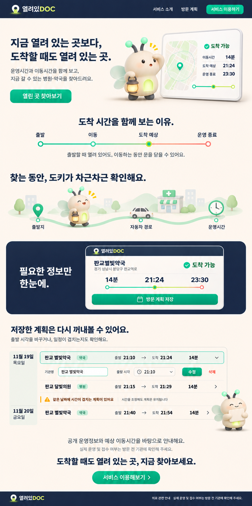

# 열려있DOC

> 지금 열려 있는 곳보다, **도착할 때도 열려 있는 곳.**

**열려있DOC**은 야간·휴일에 방문할 수 있는 병원과 약국을 찾는 도착 시각 기반 방문 플래너입니다. 출발 시각, 자동차 예상 주행시간, 공개 운영시간을 함께 계산해 사용자가 도착할 때도 운영 중인 후보를 안내하고 방문 계획으로 저장합니다.

<p align="center">
  
</p>

> [!NOTE]
> 2026년 11월 20일 기준 필수 기능 F3001~F3019를 구현했습니다. 자동 테스트 **49건**과 Python 문법 검사를 통과했고, SSAFY GMS(OpenAI)·카카오·국립중앙의료원 실제 API로 대표 시나리오 5개와 브라우저 E2E 9단계를 검증했습니다. 결과는 [검증 결과](./docs/05_검증_결과.md)에 있습니다. 심화 기능 F3020~F3023은 적용하지 않았습니다.

> [!IMPORTANT]
> 공개 운영시간과 예상 이동시간을 바탕으로 한 방문 안내입니다. 실제 운영 및 접수 여부는 방문 전 기관에 확인해 주세요. 이 서비스는 전문가의 의료 상담을 대신하지 않습니다.

## 왜 열려있DOC인가요?

검색할 때 문을 연 가장 가까운 기관도 이동하는 동안 영업이 끝날 수 있습니다. 열려있DOC은 단순 거리나 현재 영업 여부가 아니라 **예상 도착 시각**을 기준으로 방문 가능성을 판단합니다.

```text
예상 도착 시각 = 출발 시각 + 자동차 예상 주행시간
```

다음 조건을 모두 만족한 후보만 방문 가능 대상으로 선택합니다.

- 주행시간이 사용자가 정한 최대 이동시간 이내일 것
- 방문일의 공개 운영시간을 확인할 수 있을 것
- `운영 시작 시각 ≤ 예상 도착 시각 < 운영 종료 시각`일 것

마감 시각과 정확히 같은 시각에 도착하는 후보는 제외합니다. 경로나 운영시간을 확인할 수 없을 때는 값을 추측하지 않고 확인 불가 사유를 남기며, 다음 후보를 탐색합니다.

## 동작 흐름



동명 장소는 바로 선택하지 않고 사용자에게 다시 확인합니다. “30분 뒤에 출발하면?” 같은 후속 요청에서는 앞선 출발지를 유지하고 변경된 출발 시각으로 다시 계산합니다.

## 11월 18~20일 구현 내용

| 시점 | 작업 내용 |
|---|---|
| 11월 18일 | FastAPI 학습 예제를 `examples/fastapi-basics/`로 분리하고 실제 서비스용 백엔드·SQLite·프론트엔드 기본 구조를 구축했습니다. 방문 가능 판정, 계획 CRUD, 실행 로그 API와 기본 테스트를 추가했습니다. |
| 11월 19일 오전 | 브랜드 가이드·로고·UI 목업을 정리하고, 장소 검색·주변 기관 조회·기관 상세·자동차 길찾기 Tool 4종을 구현했습니다. LangGraph의 분석 → 계획 → Tool 실행 → 조건 판단 → 재계획/응답 흐름과 대화 Memory·결과 캐시를 연결했습니다. |
| 11월 19일 오후 | 추천 결과에서 바로 저장할 수 있는 계획 초안과 단계별 실행 이벤트 로깅을 추가했습니다. FastAPI에서 프론트엔드를 함께 제공하고, 랜딩·대화형 검색·추천 결과·방문 계획 조회/상세/수정/삭제 UI를 브랜드 디자인에 맞춰 완성했습니다. |
| 11월 20일 | 이벤트 발행과 Logging Agent를 in-process 발행·구독 구조로 분리했습니다. 요청별 `request_id`, 세션 실행 로그 상세 API를 추가하고, 화면의 진행 단계를 타이머 대신 실제로 기록된 이벤트로 표시하도록 바꿨습니다. |
| 11월 20일 오전 | SSAFY GMS·카카오·국립중앙의료원 실제 API로 대표 시나리오 5개와 브라우저 E2E를 검증하고, 실행 로그·화면 캡처·제출 문서(`docs/`)를 정리했습니다. |

### 현재 구현 상태

| 기능 | 상태 | 설명 |
|---|:---:|---|
| 서버 상태 및 연동 설정 확인 | ✅ | DB 상태와 외부 서비스 키의 설정 여부만 공개 |
| 도착 시각 기반 방문 가능 판정 | ✅ | 이동시간 상한, 마감 정각 제외, 자정을 넘는 운영 구간 처리 |
| SQLite 방문 계획 관리 | ✅ | 생성·목록·상세·수정·삭제 및 같은 날짜의 시간 중복 경고 |
| 실행 이벤트·로그 관리 | ✅ | 이벤트 발행자와 Logging Agent 구독자 분리, 세션·요청별 실행 순서 조회, 삭제, 비밀값 마스킹 |
| 외부 API Tool 4종 | ✅ | 장소 검색, 주변 기관, `hpid` 상세, 현재·미래 자동차 길찾기 |
| LangGraph 추천 Agent | ✅ | 요청 분석, 조건 판정, 후보 재탐색, 상한 종료, Memory와 캐시 |
| 반응형 웹 앱 | ✅ | 랜딩, 대화형 검색, 실제 이벤트 기반 진행 단계, 추천 결과, 실행 흐름(Tool 실패·제외·재계획 위치), 방문 계획 화면 |
| 추천 결과 저장·계획 관리 UI | ✅ | 결과 저장, 날짜별 목록, 상세, 출발 시각·기관명·근거 수정, 삭제 |
| 카카오·의료기관 실호출 증빙 | ✅ | 대표 시나리오 5개 실제 API 실행, [실행 로그](./docs/evidence/README.md) |
| LLM 요청 분석 실증 | ✅ | GMS 경유 `gpt-4o-mini` 구조화 분석 (`llm+rules`) |
| LLM Tool 선택 실증 | ⏳ | 고정 응답 테스트 완료, `verify_morning`으로 실제 모델 확인 필요 |

## 화면과 브랜드

### 서비스 목업

랜딩에서 서비스의 필요성을 설명하고, 검색 → 도착 가능 판정 → 계획 저장·관리까지 한 흐름으로 이어지도록 구성했습니다. 아래 이미지는 구현 기준으로 사용한 전체 랜딩 목업이며, 세부 문구와 데이터는 실제 실행 화면에서 달라질 수 있습니다.

<p align="center">
  
</p>

### 마스코트 ‘도키’

**도키**는 밤길에 작은 안내등을 들고 사용자의 방문 경로를 확인하는 길잡이입니다. 배의 열린 문 모양 불빛은 “도착할 때도 열려 있는 곳”이라는 서비스 약속을 상징합니다. 검색 중에는 경로와 운영시간을 살피고, 추천 성공과 계획 저장 단계에서는 결과를 부드럽게 안내합니다. 의료 정보를 가리지 않도록 화면의 보조 요소로만 사용합니다.

<p align="center">
  
</p>

로고와 화면별 세부 사용 기준은 [열려있DOC 디자인 가이드](./design/yeollyeo-doc/DESIGN_GUIDE.md)에서 확인할 수 있습니다.

## 주요 화면

- **서비스 소개**: 도착 시각을 함께 확인해야 하는 이유와 탐색 과정을 설명합니다.
- **대화형 방문 검색**: 출발지, 출발 시각, 병원/약국, 최대 이동시간을 자연어로 입력합니다.
- **탐색 진행 상태**: 처리 중에는 중립 상태만 보여 주고, 완료 후 실제 실행 기록으로 출발지 확인·주변 후보 조회·운영시간 확인·경로 계산·추천 완료 단계의 성공·실패를 표시합니다.
- **추천 결과**: 기관명·주소, 예상 주행시간, 도착 예상, 운영 종료, 선택 근거를 보여 줍니다.
- **실행 흐름**: LLM 판단 이유, Tool 호출 순서·성공·실패 사유·소요시간, 캐시 재사용, 후보 제외와 재계획 위치를 실행 순서대로 표시합니다.
- **방문 계획**: 결과를 저장하고 날짜별로 조회하며 상세·수정·삭제와 일정 겹침 경고를 확인합니다.

## 기술 스택

| 영역 | 기술 |
|---|---|
| Backend | Python 3.12, FastAPI 0.141.1, Pydantic 2.13.5, Uvicorn 0.52.4 |
| Agent | LangGraph 1.2.10, LangChain 1.3.14, langchain-openai 1.4.3, OpenAI 2.54.0 |
| Database | SQLite |
| Frontend | HTML, CSS, Vanilla JavaScript |
| Test | Python `unittest` |
| External API | Kakao Local, Kakao Mobility, 국립중앙의료원·공공데이터포털 |

## 프로젝트 구조

```text
backend/
  app/
    agents/          # LLM 분석, LangGraph 실행 흐름, 대화 Memory, Logging Agent(구독자)
    events.py        # 실행 이벤트 계약과 in-process 발행·구독 버스
    composition.py   # 버스·Logging Agent·Planner 조립(발행자와 구독자를 함께 아는 유일한 곳)
    api/             # health, chat, plans, logs 라우터
    repositories/    # SQLite 방문 계획·실행 로그 접근
    schemas/         # 요청·응답 모델
    services/        # 채팅 조정, 도착 시각·운영시간 판정, 실행 trace 요약
    tools/           # 외부 Tool 계약, 핸들러, 등록부
  scripts/           # 실제 키 설정 후 실행하는 실연동 검증
  data/              # 로컬 SQLite 파일(버전 관리 제외)
  tests/             # API, 판정, Agent, Tool, 저장소, 이벤트·로그, 프론트엔드 계약 테스트
design/
  yeollyeo-doc/      # 디자인 가이드, 로고, 도키, 화면 목업
examples/
  fastapi-basics/    # 11월 18일 오전 FastAPI 학습 예제
frontend/
  assets/            # 앱 로직, 스타일, 브랜드 이미지
  index.html         # 랜딩·검색·추천·방문 계획 화면
```

## 로컬 실행

Python 3.12 환경을 권장합니다. PowerShell에서 저장소 루트를 기준으로 실행합니다.

### 1. 환경 준비

```powershell
python -m venv .venv
.\.venv\Scripts\Activate.ps1
python -m pip install -r backend\requirements.txt
Copy-Item .env.example .env
```

`.env`가 이미 있다면 마지막 명령은 생략합니다. 서버·계획·로그·사용법 안내는 외부 API 키 없이 확인할 수 있습니다. 추천 기능은 필요한 키가 없을 때 결과를 임의로 만들지 않고 `setup_required`와 설정할 변수명을 반환합니다.

### 2. 서버 실행

```powershell
python -m uvicorn backend.app.main:app --reload
```

- 웹 앱: <http://localhost:8000/app/>
- API 루트: <http://localhost:8000>
- Swagger 문서: <http://localhost:8000/docs>
- 상태 확인: <http://localhost:8000/api/v1/health>

FastAPI가 `frontend/`를 `/app/`에서 함께 제공합니다. 서버는 첫 실행 시 `backend/data/planner.db`를 만들며, DB 파일과 `.env`는 Git에 포함되지 않습니다.

### 3. 프론트엔드만 실행하기 (선택)

```powershell
.\.venv\Scripts\Activate.ps1
python -m http.server 5500 --directory frontend
```

브라우저에서 <http://localhost:5500>을 엽니다. 프론트엔드는 로컬 실행 시 기본적으로 `http://localhost:8000/api/v1`의 API를 사용합니다.

## 환경변수

`.env.example`을 복사한 로컬 `.env`에 실제 값을 입력합니다. 키 원문은 문서·화면·로그·커밋에 남기지 않습니다.

| 변수 | 기본값 | 용도 |
|---|---|---|
| `APP_ENV` | `local` | 실행 환경 이름 |
| `DATABASE_PATH` | `backend/data/planner.db` | SQLite 파일 경로 |
| `CORS_ORIGINS` | 로컬 프론트 주소 | 허용할 Origin, 쉼표로 구분 |
| `REPLAN_LIMIT` | `5` | 후보 재탐색 횟수 상한 |
| `UPSTREAM_TIMEOUT_SECONDS` | `10` | 외부 API 요청 제한시간 |
| `OPENAI_API_KEY` | 비어 있음 | 요청 분석에 사용할 키. SSAFY GMS 키 사용 |
| `OPENAI_API_BASE` | 비어 있음 | GMS 키를 쓸 때 필수. `https://gms.ssafy.io/gmsapi/api.openai.com/v1` |
| `OPENAI_MODEL` | 비어 있음 | 요청 분석에 사용할 모델 이름. 검증은 `gpt-4o-mini` |
| `KAKAO_REST_API_KEY` | 비어 있음 | Kakao Local·Mobility API |
| `NMC_SERVICE_KEY` | 비어 있음 | 국립중앙의료원·공공데이터포털 API |

환경변수를 바꾼 뒤에는 백엔드 서버를 다시 시작합니다. API는 키 원문을 반환하거나 로그에 기록하지 않고 설정 여부만 보여 줍니다.

> [!WARNING]
> - `OPENAI_API_BASE` 없이 GMS 키를 쓰면 요청이 OpenAI 기본 주소로 가서 401 오류가 납니다. 이때 서비스는 멈추지 않고 규칙 기반 분석(`rules_fallback`)으로 대체하므로, 실행 로그의 `source`로 LLM 사용 여부를 확인하세요.
> - 설정 코드는 이미 있는 OS·터미널 환경변수를 `.env`보다 우선합니다(`load_dotenv(override=False)`). `.env`를 바꿨는데 반영되지 않으면 열려 있는 PowerShell 창을 모두 닫고 새 창 하나에서 서버를 실행하세요. `--reload`로 띄운 서버는 `Ctrl+C` 뒤에도 프로세스가 남을 수 있으니 `Get-NetTCPConnection -LocalPort 8000 -State Listen`으로 확인합니다.

## API 키 발급과 설정

| 변수 | 발급처 | 절차 요약 |
|---|---|---|
| `OPENAI_API_KEY`, `OPENAI_API_BASE` | [SSAFY GMS](https://gms.ssafy.io/web/) | "Key 발급 신청" → 승인 후 "Key 조회"에서 확인. 남은 크레딧은 `GET https://gms.ssafy.io/gmsapi/key-info` (Bearer 인증)로 확인 |
| `KAKAO_REST_API_KEY` | [Kakao Developers](https://developers.kakao.com/) | 앱 생성 → 앱 키의 REST API 키 사용. 카카오맵(로컬) 사용 설정. 같은 키로 [카카오모빌리티 길찾기](https://developers.kakaomobility.com/) 호출 |
| `NMC_SERVICE_KEY` | [공공데이터포털](https://www.data.go.kr/) | [전국 약국 정보 조회 서비스](https://www.data.go.kr/data/15000576/openapi.do)와 [전국 병·의원 찾기 서비스](https://www.data.go.kr/data/15000736/openapi.do) 활용신청 → 마이페이지의 일반 인증키 사용 |

## 외부 API 출처와 이용 조건

2026-11-20에 각 제공처 페이지에서 확인한 내용입니다. 한도와 요금은 제공처 사정으로 바뀔 수 있으므로 제출·운영 전에 다시 확인합니다.

| API | 제공처 | 사용 오퍼레이션 | 호출 한도 | 이용 조건 |
|---|---|---|---|---|
| 전국 약국 정보 조회 서비스 | 국립중앙의료원 (공공데이터포털 15000576) | 약국 위치정보 조회 `getParmacyLcinfoInqire`, 약국별 기본정보 조회 `getParmacyBassInfoInqire` | 계정별 일일 허용량. 공개 상세 페이지에 수치가 없어 활용신청 상세(마이페이지)에서 확인. 초과 시 결과 코드 22 | 무료, 이용허락범위 제한 없음 |
| 전국 병·의원 찾기 서비스 | 국립중앙의료원 (공공데이터포털 15000736) | 병·의원 위치정보 조회 `getHsptlMdcncLcinfoInqire`, 병·의원별 기본정보 조회 `getHsptlBassInfoInqire` | 위와 같음 | 무료, 이용허락범위 제한 없음 |
| 카카오 로컬 키워드로 장소 검색 | Kakao Developers | `GET /v2/local/search/keyword.json` | 일 100,000건 무료, 초과분은 유료 API 적용 시 건당 과금 ([쿼터](https://developers.kakao.com/docs/ko/getting-started/quota)) | [운영정책](https://developers.kakao.com/terms/ko/site-policies): 쿼터 준수, 데이터·키 제3자 제공 금지, 캐시는 사용자 환경 개선 목적·최신 상태 유지 |
| 카카오모빌리티 자동차 길찾기 | 카카오모빌리티 | `GET /v1/directions` | 일 10,000건 무료, 초과분 건당 과금 ([가격](https://developers.kakaomobility.com/price/)) | 제공처 정책 준수 |
| 카카오모빌리티 미래 운행 정보 길찾기 | 카카오모빌리티 | `GET /v1/future/directions` | 일 5,000건 무료, 초과분 건당 과금 ([가격](https://developers.kakaomobility.com/price/)) | 제공처 정책 준수 |
| OpenAI `gpt-4o-mini` (GMS 경유) | SSAFY GMS | LangChain `ChatOpenAI` 구조화 출력 | 팀별 발급 크레딧 범위 | GMS 안내: 키를 클라이언트 코드에 하드코딩하지 않고 서버 환경변수로 관리 |

서비스 운영 방침
- 운영시간과 경로는 제공처 응답 값을 그대로 쓰고, 없는 값은 "확인 필요" 또는 "경로 확인 불가"로 표시합니다.
- 요청당 Tool 결과는 같은 대화 세션 안에서만 캐시하고, 서버를 재시작하면 사라집니다. 외부 API 원본 응답은 저장하지 않습니다.
- 공개 운영시간 기반 안내이며 실제 운영·접수 여부와 의료 판단은 기관과 전문가에게 확인하도록 안내합니다.

## 필수·심화 기능 구분

| 구분 | 요구사항 | 적용 |
|---|---|---|
| 필수 | F3001~F3019 (Tool 4종, LangGraph Agent, 이벤트·로깅 Agent, 계획 관리, FastAPI, 화면) | 모두 구현·검증 |
| 심화 | F3020 이상 징후 판단, F3021 Planner·Worker, F3022 RAG Tool, F3023 캘린더 Tool | 적용하지 않음 |

## 외부 Tool

| Tool | 역할 |
|---|---|
| `search_place` | 출발지 이름을 좌표로 변환하고 동명 장소 여부 확인 |
| `search_nearby_institutions` | 출발지 주변 병원·약국 후보와 기관 ID 조회 |
| `get_institution_detail` | `hpid` 기준 기관 상세·방문일 운영시간 조회 |
| `get_driving_route` | 출발 시각에 맞춰 현재 또는 미래 자동차 경로·주행시간 계산 |

`GET /api/v1/meta/tools`에서 각 Tool의 사용 시점, 입력·출력, 실패 코드와 구현 여부를 확인할 수 있습니다. `GET /api/v1/meta/graph`는 현재 LangGraph 구조를 Mermaid 문자열로 반환합니다.

## API

| 메서드 | 경로 | 설명 |
|---|---|---|
| `GET` | `/api/v1/health` | DB와 외부 연동 설정 여부 확인 |
| `GET` | `/api/v1/meta/tools` | Tool 계약과 구현 상태 확인 |
| `GET` | `/api/v1/meta/graph` | LangGraph 노드와 조건 분기 확인 |
| `POST` | `/api/v1/chat` | 사용법 안내 또는 추천 Agent 실행. 응답의 `request_id`로 이번 실행 trace를 조회 |
| `POST/GET` | `/api/v1/plans` | 방문 계획 저장·목록 조회 |
| `GET/PATCH/DELETE` | `/api/v1/plans/{id}` | 방문 계획 상세·수정·삭제 |
| `GET` | `/api/v1/logs` | 실행 로그 목록. `session_id`·`request_id` 필터, `order=desc`(기본)/`asc` |
| `GET` | `/api/v1/logs/sessions/{session_id}` | 세션 전체 로그를 실행 순서로 조회. `requests`·`latest_request_id` 제공, `?request_id=` 또는 `?latest=true`로 한 실행과 요약(`summary`) 조회 |
| `GET/DELETE` | `/api/v1/logs/{id}` | 실행 로그 단건 상세·삭제 (수정 API 없음) |

계획 시각은 ISO 8601 형식을 사용합니다. 시간대가 없는 값은 한국 표준시(`UTC+09:00`)로 해석하고, 다른 시간대가 있으면 한국 표준시로 정규화합니다.

## 사용 예시

```text
성남 판교역 신분당선에서 오늘 밤 9시에 출발해서
차로 20분 안에 도착할 수 있는 약국을 찾아줘.
```

연동 키가 설정되면 기관명·주소, 예상 주행시간과 도착 시각, 방문일의 공개 운영시간, 후보 선택 근거를 함께 안내합니다. 조건을 만족하는 후보가 없으면 탐색 범위와 후보별 제외 사유를 설명합니다.

## 테스트

전체 자동 테스트를 실행합니다.

```powershell
.\.venv\Scripts\python.exe -m unittest discover -s backend\tests -v
```

정적 import와 Python 문법을 함께 확인합니다.

```powershell
.\.venv\Scripts\python.exe -m compileall -q backend
```

2026년 11월 20일 기준 **49개 테스트가 통과**합니다. 테스트 범위는 다음과 같습니다.

- 마감 정각 제외, 이동시간 상한 포함, 자정을 넘는 운영 구간
- Tool 정상·실패 형식, 키 누락, 운영시간 누락, `hpid → 상세` 연결
- 현재·미래 길찾기 선택과 동명 장소 확인
- 경로 실패 후 다음 후보 재계획, 재계획 상한
- 후속 대화의 출발지 Memory와 결과 캐시 재사용
- 방문 계획 CRUD와 시간 중복 경고, 규칙 위반 수정의 422 응답
- 실행 로그의 비밀값 마스킹(키 이름·키처럼 보이는 값)과 API 계약
- 이벤트 구독자 0개·예외 구독자·저장 실패에서도 Planner 정상 응답, Planner의 로깅 구현 비참조
- 단계 진입·종료 쌍, Tool 요청·응답과 소요시간, 규칙/LLM 판단 이유, 캐시 재사용 표시
- 세션 로그 실행 순서, 세션 간 분리, 같은 세션의 요청별 `request_id` 구분, 기존 DB 마이그레이션
- Tool 불필요 요청의 Tool 0회, Tool 실패 → 후보 제외 → 재계획 trace, 재계획 상한 trace
- 프론트엔드가 타이머 없이 실행별 trace를 조회하는지 정적 계약 검사

## 실제 API 연동 검증

`.env`에 네 연동 값을 설정한 뒤 다음 명령을 실행합니다.

```powershell
.\.venv\Scripts\python.exe -m backend.scripts.verify_morning
```

검증 스크립트는 키 원문과 외부 API 원본 응답을 출력하지 않고 다음 요약 증빙만 JSON으로 출력합니다.

- 일반 요청에 대한 LLM 응답과 장소 검색 Tool 선택 (아직 실행하지 않음)
- 판교역 좌표와 주변 병·의원 1곳의 기관 ID·좌표·운영시간·적용일
- 목록의 `hpid`와 상세 응답 기관 ID의 일치 여부
- 공휴일 운영시간 또는 `확인 필요` 상태
- 즉시 출발 자동차 길찾기 결과

재계획 상한 시나리오와 응답시간 측정은 서버 없이 같은 코드 경로로 실행할 수 있습니다. 각각 `.bat` 파일을 더블클릭해도 됩니다.

```powershell
# 재계획 상한(1회) 시나리오 → docs/evidence/scenario-replan-limit.json
.\.venv\Scripts\python.exe -m backend.scripts.run_replan_limit_scenario

# NF3005 응답시간: 정상 추천 20회, p50/p95/최대 → docs/evidence/perf-response-time.json
.\.venv\Scripts\python.exe -m backend.scripts.measure_response_time
```

## 검증 결과 요약 (2026-11-20)

| 구분 | 결과 |
|---|---|
| 대표 시나리오 5개 (실제 API) | 정상 추천, 재계획, 상한 도달, Tool 실패(경로 코드 104) 후 대안, Tool 불필요 모두 통과 |
| 브라우저 E2E | 추천 → 저장 → 목록·상세 → 수정 → 새로고침 → 서버 재시작 → 겹침 경고 → 삭제 → API 문서·그래프 9단계 통과 |
| 응답시간 (NF3005) | 기준 p95 10초 이내. 정상 추천 4회 중앙값 약 5.8초, 최대 6.2초 (잠정, 20회 측정 스크립트로 확정) |
| 알려진 문제 | 사용성 2건 ([검증 결과 10절](./docs/05_검증_결과.md)) |

## 남은 과제

1. 실제 모델의 Tool 선택 확인 (`verify_morning`)
2. 병원 추천, 공휴일·자정 넘김 운영시간의 실데이터 확인
3. 응답시간 20회 측정으로 p95 확정 (`measure_response_time`)
4. 3일 차 셀프 체크리스트 점검

## 제출 문서

| 문서 | 내용 |
|---|---|
| [요구사항 정의서](./docs/01_요구사항_정의서.md) | 도메인 근거, 기능·비기능 요구사항 표, 기획 검증 결과 |
| [Agent 설계](./docs/02_Agent_설계.md) | 실행 단계와 입출력, 재계획 조건, 이벤트 흐름, Memory |
| [Tool 정의서](./docs/03_Tool_정의서.md) | Tool 4종 명세, 실패 코드, 등록·확장 방법 |
| [API 명세서](./docs/04_API_명세서.md) | 경로, 요청·응답 형식, 계획·로그 API |
| [검증 결과](./docs/05_검증_결과.md) | 대표 시나리오, 확인 항목별 결과, 응답시간, 알려진 문제 |
| [실행 로그 샘플과 증빙](./docs/evidence/README.md) | 실제 실행 로그 JSON, E2E 기록 |
| [화면 캡처](./docs/images/) | 추천·실행 흐름·계획 관리·API 문서·LangGraph 구조 |

## 참고 문서

- [열려있DOC 디자인 가이드](./design/yeollyeo-doc/DESIGN_GUIDE.md)
- [주제 정의서](./야간휴일_병원약국_방문플래너_주제정의서.md)
- [1일 차 검증 기록](./전국_야간휴일_병원약국_방문플래너_1일차_검증기록.md)
- [2일 차 작업 체크리스트](./전국_야간휴일_병원약국_방문플래너_2일차_작업체크리스트.md)
- [검증·디버깅 계획](./전국_야간휴일_병원약국_방문플래너_검증_디버깅_계획.md)
