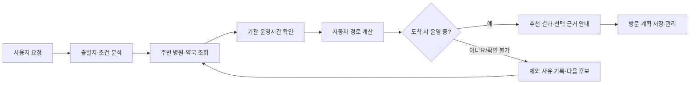

# 열려있DOC

> 지금 열려 있는 곳보다, **도착할 때도 열려 있는 곳.**

**열려있DOC**은 야간·휴일에 방문할 수 있는 병원과 약국을 찾는 도착 시각 기반 방문 플래너입니다. 출발 시각, 자동차 예상 주행시간, 공개 운영시간을 함께 계산해 사용자가 도착할 때도 운영 중인 후보를 안내하고 방문 계획으로 저장합니다.

<p align="center">
  
</p>

> [!NOTE]
> 2026년 11월 19일 기준 FastAPI 백엔드, SQLite 방문 계획·실행 로그, 외부 API Tool 4종, LangGraph 추천·재계획 흐름, 반응형 랜딩·검색·추천·방문 계획 화면까지 구현했습니다. 자동 테스트 **20건**과 Python 문법 검사를 통과했으며, OpenAI·카카오·국립중앙의료원 실제 키를 사용한 실호출 증빙은 별도 진행이 필요합니다.

> [!IMPORTANT]
> 공개 운영시간과 예상 이동시간을 바탕으로 한 방문 안내입니다. 실제 운영 및 접수 여부는 방문 전 기관에 확인해 주세요. 이 서비스는 전문가의 의료 상담을 대신하지 않습니다.

## 왜 열려있DOC인가요?

검색할 때 문을 연 가장 가까운 기관도 이동하는 동안 영업이 끝날 수 있습니다. 열려있DOC은 단순 거리나 현재 영업 여부가 아니라 **예상 도착 시각**을 기준으로 방문 가능성을 판단합니다.

```text
예상 도착 시각 = 출발 시각 + 자동차 예상 주행시간
```

다음 조건을 모두 만족한 후보만 방문 가능 대상으로 선택합니다.

- 주행시간이 사용자가 정한 최대 이동시간 이내일 것
- 방문일의 공개 운영시간을 확인할 수 있을 것
- `운영 시작 시각 ≤ 예상 도착 시각 < 운영 종료 시각`일 것

마감 시각과 정확히 같은 시각에 도착하는 후보는 제외합니다. 경로나 운영시간을 확인할 수 없을 때는 값을 추측하지 않고 확인 불가 사유를 남기며, 다음 후보를 탐색합니다.

## 동작 흐름



동명 장소는 바로 선택하지 않고 사용자에게 다시 확인합니다. “30분 뒤에 출발하면?” 같은 후속 요청에서는 앞선 출발지를 유지하고 변경된 출발 시각으로 다시 계산합니다.

## 11월 18~19일 구현 내용

| 시점 | 작업 내용 |
|---|---|
| 11월 18일 | FastAPI 학습 예제를 `examples/fastapi-basics/`로 분리하고 실제 서비스용 백엔드·SQLite·프론트엔드 기본 구조를 구축했습니다. 방문 가능 판정, 계획 CRUD, 실행 로그 API와 기본 테스트를 추가했습니다. |
| 11월 19일 오전 | 브랜드 가이드·로고·UI 목업을 정리하고, 장소 검색·주변 기관 조회·기관 상세·자동차 길찾기 Tool 4종을 구현했습니다. LangGraph의 분석 → 계획 → Tool 실행 → 조건 판단 → 재계획/응답 흐름과 대화 Memory·결과 캐시를 연결했습니다. |
| 11월 19일 오후 | 추천 결과에서 바로 저장할 수 있는 계획 초안과 단계별 실행 이벤트 로깅을 추가했습니다. FastAPI에서 프론트엔드를 함께 제공하고, 랜딩·대화형 검색·추천 결과·방문 계획 조회/상세/수정/삭제 UI를 브랜드 디자인에 맞춰 완성했습니다. |

### 현재 구현 상태

| 기능 | 상태 | 설명 |
|---|:---:|---|
| 서버 상태 및 연동 설정 확인 | ✅ | DB 상태와 외부 서비스 키의 설정 여부만 공개 |
| 도착 시각 기반 방문 가능 판정 | ✅ | 이동시간 상한, 마감 정각 제외, 자정을 넘는 운영 구간 처리 |
| SQLite 방문 계획 관리 | ✅ | 생성·목록·상세·수정·삭제 및 같은 날짜의 시간 중복 경고 |
| 실행 이벤트·로그 관리 | ✅ | 단계·Tool·판단·재계획 이벤트 저장, 세션별 조회·삭제, 비밀값 마스킹 |
| 외부 API Tool 4종 | ✅ | 장소 검색, 주변 기관, `hpid` 상세, 현재·미래 자동차 길찾기 |
| LangGraph 추천 Agent | ✅ | 요청 분석, 조건 판정, 후보 재탐색, 상한 종료, Memory와 캐시 |
| 반응형 웹 앱 | ✅ | 랜딩, 대화형 검색, 진행 단계, 추천 결과, 실행 흐름, 방문 계획 화면 |
| 추천 결과 저장·계획 관리 UI | ✅ | 결과 저장, 날짜별 목록, 상세, 출발 시각·기관명·근거 수정, 삭제 |
| 카카오·의료기관 실호출 증빙 | ⏳ | 구현·모의 응답 검증 완료, 실제 키를 사용한 결과 기록 필요 |
| OpenAI 응답·Tool 선택 실증 | ⏳ | Tool 등록·고정 테스트 완료, 실제 모델 호출 결과 기록 필요 |

## 화면과 브랜드

### 서비스 목업

랜딩에서 서비스의 필요성을 설명하고, 검색 → 도착 가능 판정 → 계획 저장·관리까지 한 흐름으로 이어지도록 구성했습니다. 아래 이미지는 구현 기준으로 사용한 전체 랜딩 목업이며, 세부 문구와 데이터는 실제 실행 화면에서 달라질 수 있습니다.

<p align="center">
  
</p>

### 마스코트 ‘도키’

**도키**는 밤길에 작은 안내등을 들고 사용자의 방문 경로를 확인하는 길잡이입니다. 배의 열린 문 모양 불빛은 “도착할 때도 열려 있는 곳”이라는 서비스 약속을 상징합니다. 검색 중에는 경로와 운영시간을 살피고, 추천 성공과 계획 저장 단계에서는 결과를 부드럽게 안내합니다. 의료 정보를 가리지 않도록 화면의 보조 요소로만 사용합니다.

<p align="center">
  
</p>

로고와 화면별 세부 사용 기준은 [열려있DOC 디자인 가이드](./design/yeollyeo-doc/DESIGN_GUIDE.md)에서 확인할 수 있습니다.

## 주요 화면

- **서비스 소개**: 도착 시각을 함께 확인해야 하는 이유와 탐색 과정을 설명합니다.
- **대화형 방문 검색**: 출발지, 출발 시각, 병원/약국, 최대 이동시간을 자연어로 입력합니다.
- **탐색 진행 상태**: 출발지 확인, 주변 후보 조회, 운영시간 확인, 경로 계산, 추천 완료 단계를 표시합니다.
- **추천 결과**: 기관명·주소, 예상 주행시간, 도착 예상, 운영 종료, 선택 근거를 보여 줍니다.
- **실행 흐름**: 호출한 Tool과 재계획 횟수, 첫 후보 제외 사유를 사용자가 이해할 수 있는 문장으로 표시합니다.
- **방문 계획**: 결과를 저장하고 날짜별로 조회하며 상세·수정·삭제와 일정 겹침 경고를 확인합니다.

## 기술 스택

| 영역 | 기술 |
|---|---|
| Backend | Python 3.12, FastAPI 0.141.1, Pydantic 2.13.5, Uvicorn 0.52.4 |
| Agent | LangGraph 1.2.10, LangChain 1.3.14, langchain-openai 1.4.3, OpenAI 2.54.0 |
| Database | SQLite |
| Frontend | HTML, CSS, Vanilla JavaScript |
| Test | Python `unittest` |
| External API | Kakao Local, Kakao Mobility, 국립중앙의료원·공공데이터포털 |

## 프로젝트 구조

```text
backend/
  app/
    agents/          # LLM 분석, LangGraph 실행 흐름, 대화 Memory, 로깅 경계
    api/             # health, chat, plans, logs 라우터
    repositories/    # SQLite 방문 계획·실행 로그 접근
    schemas/         # 요청·응답 모델
    services/        # 채팅 조정, 도착 시각·운영시간 판정
    tools/           # 외부 Tool 계약, 핸들러, 등록부
  scripts/           # 실제 키 설정 후 실행하는 실연동 검증
  data/              # 로컬 SQLite 파일(버전 관리 제외)
  tests/             # API, 판정, Agent, Tool, 저장소 테스트
design/
  yeollyeo-doc/      # 디자인 가이드, 로고, 도키, 화면 목업
examples/
  fastapi-basics/    # 11월 18일 오전 FastAPI 학습 예제
frontend/
  assets/            # 앱 로직, 스타일, 브랜드 이미지
  index.html         # 랜딩·검색·추천·방문 계획 화면
```

## 로컬 실행

Python 3.12 환경을 권장합니다. PowerShell에서 저장소 루트를 기준으로 실행합니다.

### 1. 환경 준비

```powershell
python -m venv .venv
.\.venv\Scripts\Activate.ps1
python -m pip install -r backend\requirements.txt
Copy-Item .env.example .env
```

`.env`가 이미 있다면 마지막 명령은 생략합니다. 서버·계획·로그·사용법 안내는 외부 API 키 없이 확인할 수 있습니다. 추천 기능은 필요한 키가 없을 때 결과를 임의로 만들지 않고 `setup_required`와 설정할 변수명을 반환합니다.

### 2. 서버 실행

```powershell
python -m uvicorn backend.app.main:app --reload
```

- 웹 앱: <http://localhost:8000/app/>
- API 루트: <http://localhost:8000>
- Swagger 문서: <http://localhost:8000/docs>
- 상태 확인: <http://localhost:8000/api/v1/health>

FastAPI가 `frontend/`를 `/app/`에서 함께 제공합니다. 서버는 첫 실행 시 `backend/data/planner.db`를 만들며, DB 파일과 `.env`는 Git에 포함되지 않습니다.

### 3. 프론트엔드만 실행하기 (선택)

```powershell
.\.venv\Scripts\Activate.ps1
python -m http.server 5500 --directory frontend
```

브라우저에서 <http://localhost:5500>을 엽니다. 프론트엔드는 로컬 실행 시 기본적으로 `http://localhost:8000/api/v1`의 API를 사용합니다.

## 환경변수

`.env.example`을 복사한 로컬 `.env`에 실제 값을 입력합니다. 키 원문은 문서·화면·로그·커밋에 남기지 않습니다.

| 변수 | 기본값 | 용도 |
|---|---|---|
| `APP_ENV` | `local` | 실행 환경 이름 |
| `DATABASE_PATH` | `backend/data/planner.db` | SQLite 파일 경로 |
| `CORS_ORIGINS` | 로컬 프론트 주소 | 허용할 Origin, 쉼표로 구분 |
| `REPLAN_LIMIT` | `5` | 후보 재탐색 횟수 상한 |
| `UPSTREAM_TIMEOUT_SECONDS` | `10` | 외부 API 요청 제한시간 |
| `OPENAI_API_KEY` | 비어 있음 | 요청 분석에 사용할 OpenAI API 키 |
| `OPENAI_MODEL` | 비어 있음 | 요청 분석에 사용할 모델 이름 |
| `KAKAO_REST_API_KEY` | 비어 있음 | Kakao Local·Mobility API |
| `NMC_SERVICE_KEY` | 비어 있음 | 국립중앙의료원·공공데이터포털 API |

환경변수를 바꾼 뒤에는 백엔드 서버를 다시 시작합니다. API는 키 원문을 반환하거나 로그에 기록하지 않고 설정 여부만 보여 줍니다.

## 외부 Tool

| Tool | 역할 |
|---|---|
| `search_place` | 출발지 이름을 좌표로 변환하고 동명 장소 여부 확인 |
| `search_nearby_institutions` | 출발지 주변 병원·약국 후보와 기관 ID 조회 |
| `get_institution_detail` | `hpid` 기준 기관 상세·방문일 운영시간 조회 |
| `get_driving_route` | 출발 시각에 맞춰 현재 또는 미래 자동차 경로·주행시간 계산 |

`GET /api/v1/meta/tools`에서 각 Tool의 사용 시점, 입력·출력, 실패 코드와 구현 여부를 확인할 수 있습니다. `GET /api/v1/meta/graph`는 현재 LangGraph 구조를 Mermaid 문자열로 반환합니다.

## API

| 메서드 | 경로 | 설명 |
|---|---|---|
| `GET` | `/api/v1/health` | DB와 외부 연동 설정 여부 확인 |
| `GET` | `/api/v1/meta/tools` | Tool 계약과 구현 상태 확인 |
| `GET` | `/api/v1/meta/graph` | LangGraph 노드와 조건 분기 확인 |
| `POST` | `/api/v1/chat` | 사용법 안내 또는 추천 Agent 실행 |
| `POST/GET` | `/api/v1/plans` | 방문 계획 저장·목록 조회 |
| `GET/PATCH/DELETE` | `/api/v1/plans/{id}` | 방문 계획 상세·수정·삭제 |
| `GET` | `/api/v1/logs` | 실행 로그 목록, `session_id` 필터 지원 |
| `GET/DELETE` | `/api/v1/logs/{id}` | 실행 로그 상세·삭제 |

계획 시각은 ISO 8601 형식을 사용합니다. 시간대가 없는 값은 한국 표준시(`UTC+09:00`)로 해석하고, 다른 시간대가 있으면 한국 표준시로 정규화합니다.

## 사용 예시

```text
성남 판교역 신분당선에서 오늘 밤 9시에 출발해서
차로 20분 안에 도착할 수 있는 약국을 찾아줘.
```

연동 키가 설정되면 기관명·주소, 예상 주행시간과 도착 시각, 방문일의 공개 운영시간, 후보 선택 근거를 함께 안내합니다. 조건을 만족하는 후보가 없으면 탐색 범위와 후보별 제외 사유를 설명합니다.

## 테스트

전체 자동 테스트를 실행합니다.

```powershell
.\.venv\Scripts\python.exe -m unittest discover -s backend\tests -v
```

정적 import와 Python 문법을 함께 확인합니다.

```powershell
.\.venv\Scripts\python.exe -m compileall -q backend
```

2026년 11월 19일 기준 **20개 테스트가 통과**합니다. 테스트 범위는 다음과 같습니다.

- 마감 정각 제외, 이동시간 상한 포함, 자정을 넘는 운영 구간
- Tool 정상·실패 형식, 키 누락, 운영시간 누락, `hpid → 상세` 연결
- 현재·미래 길찾기 선택과 동명 장소 확인
- 경로 실패 후 다음 후보 재계획, 재계획 상한
- 후속 대화의 출발지 Memory와 결과 캐시 재사용
- 방문 계획 CRUD와 시간 중복 경고
- 실행 로그의 비밀값 마스킹과 API 계약

## 실제 API 연동 검증

`.env`에 네 연동 값을 설정한 뒤 다음 명령을 실행합니다.

```powershell
.\.venv\Scripts\python.exe -m backend.scripts.verify_morning
```

검증 스크립트는 키 원문과 외부 API 원본 응답을 출력하지 않고 다음 요약 증빙만 JSON으로 출력합니다.

- 일반 요청에 대한 LLM 응답과 장소 검색 Tool 선택
- 판교역 좌표와 주변 병·의원 1곳의 기관 ID·좌표·운영시간·적용일
- 목록의 `hpid`와 상세 응답 기관 ID의 일치 여부
- 공휴일 운영시간 또는 `확인 필요` 상태
- 즉시 출발 자동차 길찾기 결과

## 남은 검증 과제

1. 실제 연동 키로 OpenAI Tool 선택, 카카오 장소·길찾기, 의료기관·공휴일 운영정보를 호출하고 결과 기록
2. 정상 추천·재계획·상한 종료·Tool 실패·Tool 불필요 대표 시나리오의 화면과 로그 증빙 확보
3. `/docs`, LangGraph 구조, 추천·저장·계획 관리 화면 캡처 정리
4. 실제 운영 및 접수 여부 확인 안내와 외부 API 이용 조건 최종 점검

## 참고 문서

- [열려있DOC 디자인 가이드](./design/yeollyeo-doc/DESIGN_GUIDE.md)
- [주제 정의서](./야간휴일_병원약국_방문플래너_주제정의서.md)
- [1일 차 검증 기록](./전국_야간휴일_병원약국_방문플래너_1일차_검증기록.md)
- [2일 차 작업 체크리스트](./전국_야간휴일_병원약국_방문플래너_2일차_작업체크리스트.md)
- [검증·디버깅 계획](./전국_야간휴일_병원약국_방문플래너_검증_디버깅_계획.md)
